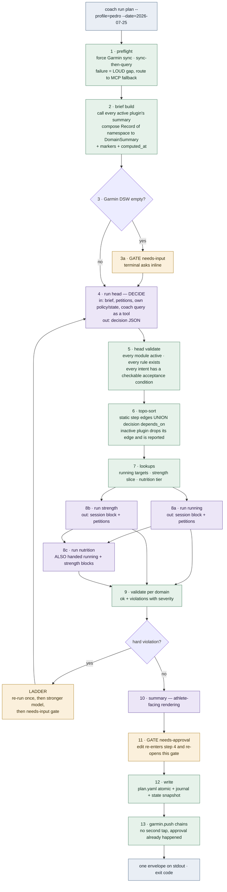
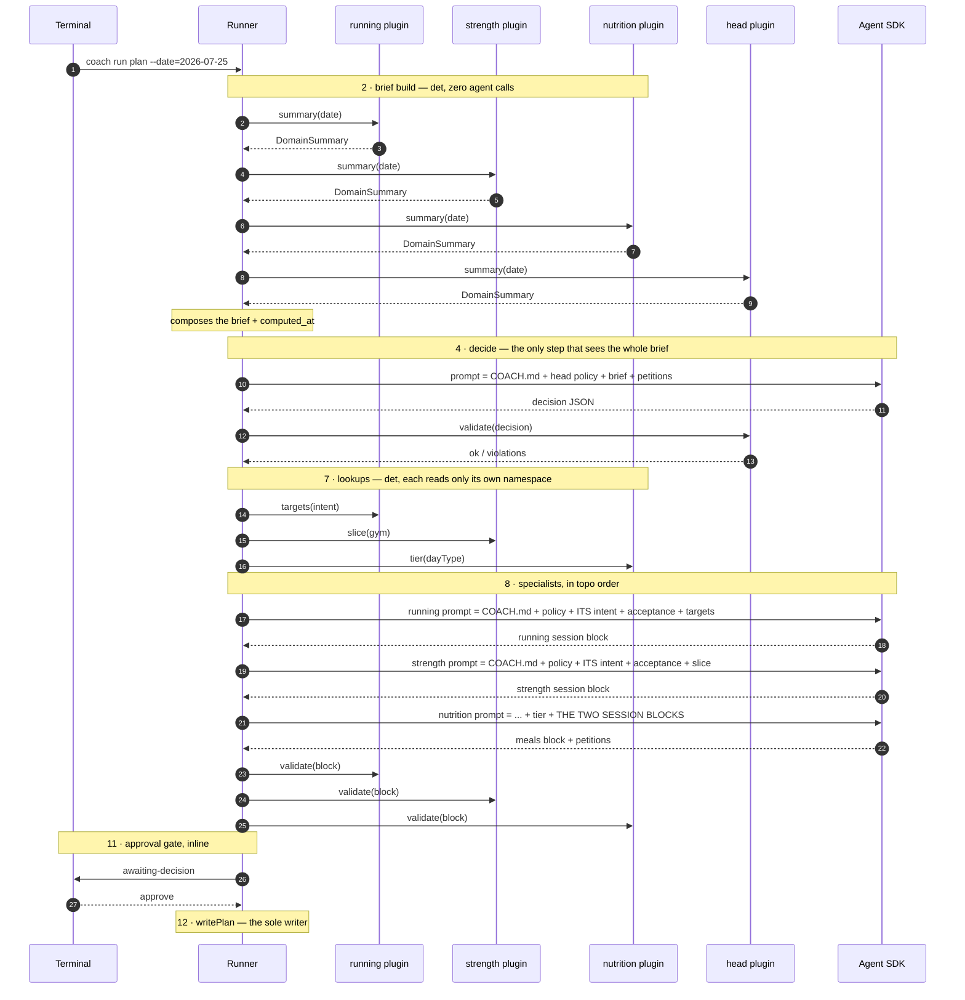
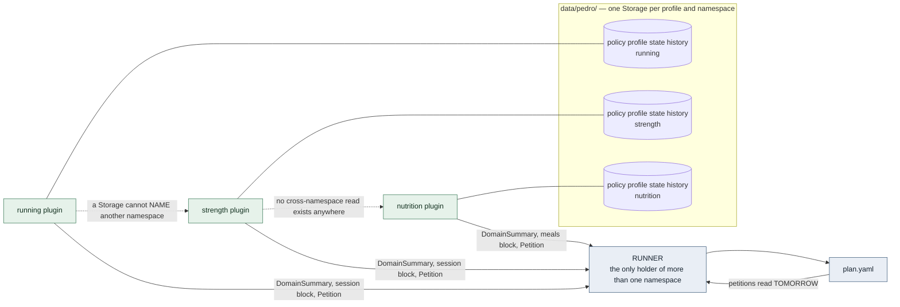
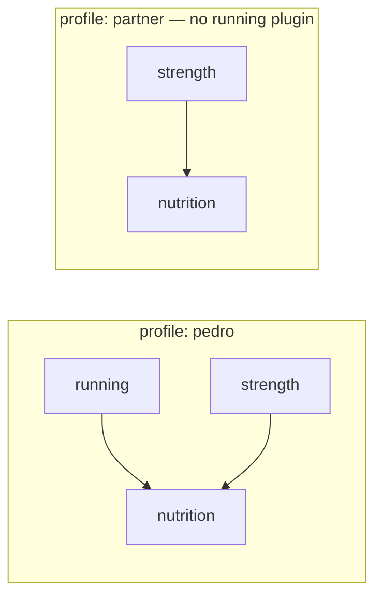

# How `coach run plan` works internally

**Status:** explanatory notes, **not authority.** The specs in `docs/superpowers/specs/` and the plan
in `docs/superpowers/plans/` decide; this file only draws what they say. Where they disagree with
this page, they win and this page is wrong.

The runner itself is **Chunk 7**; the plugins are Chunks 5–6; storage and registration are Chunk 2
(built). This describes the terminal-direct path — no n8n.

> If the diagrams below render as code blocks, install *Markdown Preview Mermaid Support* in VS Code.

---

## Step kinds: `det`, `agent`, `gate`

Every workflow step is one of three kinds. The notation comes from design spec §7's action
catalogue (`det` preflight → `gate?` → `agent` decide → …).

| Kind | What it is | Properties |
| --- | --- | --- |
| **`det`** | Deterministic pure code. No Agent SDK, no randomness, no clock read beyond the `--date` it is given. | Same profile + date + on-disk state ⇒ byte-identical output. Free, unit-testable, and what drift control pins. |
| **`agent`** | A Claude Agent SDK call. Emits **JSON** — never writes files. | Costs money, non-deterministic. Its output is always validated by a following `det` step. |
| **`gate`** | Pause for a human decision. | Synchronous/inline at the terminal; a durable n8n Wait node when driven remotely. The CLI returns the same structured `awaiting-decision` result either way. |

The architecture deliberately maximises `det` and rations `agent`. That is why `summary` is
deterministic rather than agent-written (contract §3.5), why `garmin.push` needs no agent step at
all, and why the common logging path uses none.

---

## The `plan` workflow



Note step **8c**: nutrition runs last *and* is handed running's and strength's emitted blocks.
That is one edge doing two jobs — see below.

---

## Who calls whom, and with what



---

## Data flow between plugins: there is none



Three rules cover every arrow in the system:

1. **Plugin → core** carries only *published* things: a `DomainSummary`, a `Petition`, or the block
   the coach emitted. Never a document, never a handle.
2. **Core → plugin** hands over a `Storage` bound to one namespace at construction, plus whatever
   the step passes at call time. That is the plugin's entire world.
3. **The runner is the only component holding more than one namespace** — and it holds *outputs*,
   never handles.

The dotted arrows are not a convention anybody has to remember. A `Storage` is constructed against
one `(profile, namespace)` pair and exposes no method that accepts another, so the cross-domain read
does not exist to be abused (contract §1.6, §6.2).

---

## `depends_on` does two jobs

`decision.prescribes[]` carries a per-day `depends_on`. In the prototype:

```yaml
- module: nutrition
  intent: tier
  depends_on: [running, strength]   # fuelling needs the sessions first
```

The runner sorts the **union** of the workflow's static edges and the day's decision edges — day
edges only ever *add* — then drops any edge naming an inactive plugin and reports the drop.

That single edge both **sequences** nutrition after the other two **and** tells the runner **what to
hand it**. Cross-domain information is *published and passed*, never read.

Which is what makes the second-profile compose a deletion rather than a rewrite (Chunk 13): drop the
running plugin and the edge simply vanishes — nutrition runs after strength alone, handed one block,
with no rule hand-edited anywhere.



---

## Two boundaries the diagrams make concrete

**The envelope appears once.** Terminal-direct, steps 1–12 pass **typed domain values** in-process
and `cli/coach.ts` wraps the result at the very end. Under n8n the same graph costs an envelope
round-trip *per step*, because every node execs the CLI as a fresh process. The envelope is a
property of the **CLI boundary**, not of a domain function — which is why it belongs on the CLI side
of the plugin split rather than on the plugin seam.

**`COACH.md` never touches a plugin.** The runner reads `coaches/<ns>/COACH.md` when composing a
prompt — the same place model and effort are resolved. It appears in no `Storage` handle and no
plugin reads it, which is what makes *"identity is logic, not data"* mechanical rather than a
convention (amendments §2.1).

---

## Where interpretation actually happens

Step 2 being `det` is not magic, and the diagram hides why. **Agents run at the *write* boundary,
never at the read boundary.** Every action that ingests free text has an agent step whose only job is
unstructured → structured, once:

```
"had tofu not chicken"  ──▶ meal.log      agent parses the swap
                                          ──▶ det recomputes macros vs the food table + policy
                                          ──▶ nutrition validate GATES the parse
                                          ──▶ structured row on disk
                                                    │
                            nutrition.summary()  ◀──┘   avg(actual_protein_g) over 7 rows — pure SQL
```

Same for `session.log` (parse what Garmin missed), `skin.capture` (`det` verbatim → `agent` tag →
`det` append) and `coach.chat` (routes into the other actions, never writes directly). Garmin needs
none of it — that data is already structured, so ingestion is arithmetic (haversine for splits, pace
from `avg_speed`).

Two rules make this hold rather than merely usually work:

- **The prose rule** (amendments §2.3): nothing a validator checks, a summary computes with, or a
  lookup resolves may live *only* in prose. The system does not deterministically summarise
  unstructured data — it refuses to keep mechanically-relevant data unstructured.
- **`DomainSummary` is a fact table, not a prose summary.** Bounded, five to ten numbers. "The last
  three hard sessions" is a fact; "every session" is a `query`.

The one prose channel is `observations: string[]` — one-line, windowed and capped by policy, read
from `kind: "observation"` history rows, **athlete-sourced only** (a specialist that wants to
influence the day raises a *petition*, which is mediated). Nothing in the CLI computes with them.
See `2026-07-25-plugin-seam-and-observations.md` §3.
